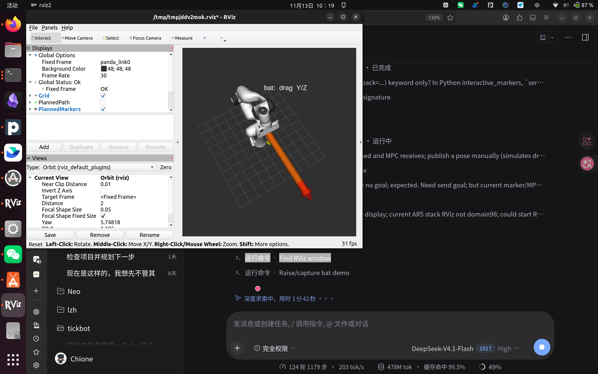

# Interactive bat obstacle demo

A Franka MPC demo with a bat-like capsule obstacle that moves automatically
along world Z.

## Control

The bat is a capsule with its long axis along world **X**. The demo moves it
automatically along **Z** (`auto_bat:=true`, default, 10 s period); X/Y are fixed. Use
`auto_bat:=false` for the manual Z-only marker.

## Run

```bash
ros2 launch curobo_mpc_cpp franka_bat_demo.launch.py

# 4. RViz
ros2 launch curobo_planner_cpp rviz.launch.py \
  base_frame:=panda_link0 \
  robot_description:=/opt/ros/humble/share/moveit_resources_panda_description/urdf/panda.urdf \
  show_robot:=true show_ghost:=true
```

The marker publishes `/curobo_world/obstacle_update`; the MPC node applies it to
its scene before each `step()`. No manual dragging is required.



## Parameters

| Parameter | Default | Meaning |
|---|---|---|
| `bat_length` | 0.6 | bat marker capsule tip-to-tip length |
| `bat_radius` | 0.03 | bat marker capsule radius |
| `world_topic` | `/curobo_world/obstacle_update` | generic obstacle input |

## Important

- Move the bat slowly; a fast teleport can tunnel through the robot.
- Dragging into the robot/target can make MPC infeasible; that is expected.
- The capsule is added once and moved with `Scene::update_obstacle_pose()`; the
  scene is not rebuilt.
- Scene updates and `step()` are serialized by the MPC mutex.
- Simulation only; no real hardware.
