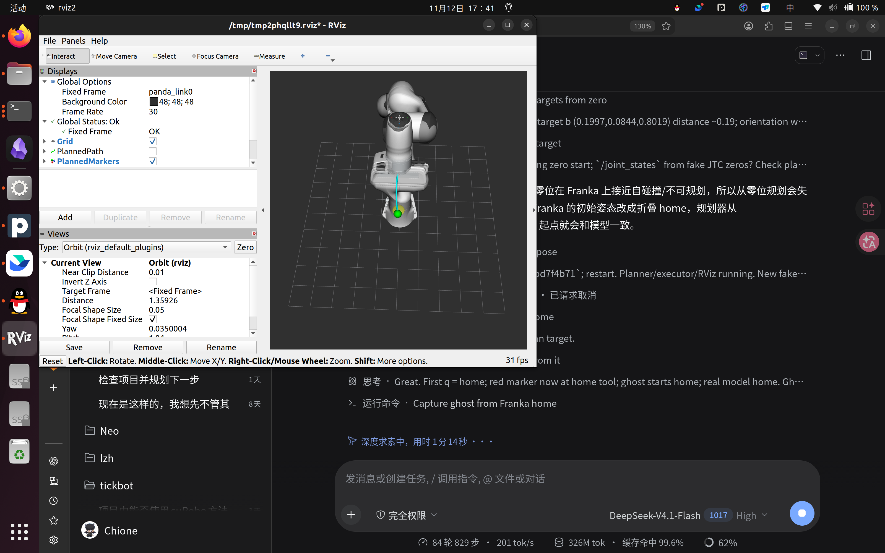
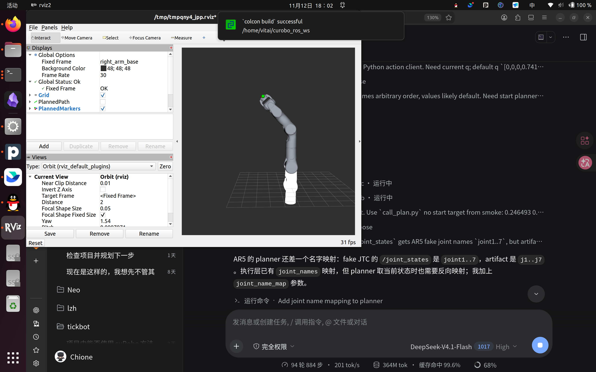

# RViz

## Displays

The default `rviz/planner.rviz` contains:

| Display | Topic | Meaning |
|---|---|---|
| `PlannedMarkers` | `/curobo_planner/planned_markers` | thin 3D cylinders + red/green start/goal |
| `SceneObjects` | `/curobo_planner/scene_markers` | cuboid/sphere/capsule/cylinder obstacles |
| `RobotModel` | `/robot_description` | current robot pose |
| `GhostRobot` | `/preview/robot_description` | translucent whole-arm replay |
| `PlannedPath` | `/curobo_planner/planned_path` | flat path, disabled by default |

The tube is rendered as `Marker::CYLINDER` segments, not a flat line.
`path_marker_radius` controls its radius (default `0.006 m`).

## Launch

Basic path only:

```bash
ros2 launch curobo_planner_cpp rviz.launch.py base_frame:=panda_link0
```

Robot model:

```bash
ros2 launch curobo_planner_cpp rviz.launch.py \
  base_frame:=panda_link0 \
  robot_description:=/opt/ros/humble/share/moveit_resources_panda_description/urdf/panda.urdf \
  show_robot:=true
```

Robot model + looping ghost:

```bash
ros2 launch curobo_planner_cpp rviz.launch.py \
  base_frame:=panda_link0 \
  robot_description:=/opt/ros/humble/share/moveit_resources_panda_description/urdf/panda.urdf \
  show_robot:=true show_ghost:=true \
  ghost_time_scale:=0.2 ghost_loop:=true
```

- `show_robot` enables the real RobotModel.
- `show_ghost` starts `preview_replay`, a second `robot_state_publisher`
  (`preview/` namespace) and a static `panda_link0 -> preview/panda_link0`
  transform.
- `ghost_time_scale < 1` slows the replay.
- `ghost_loop:=true` replays from red to green repeatedly.

## Ghost

`preview_replay` subscribes to `/curobo_planner/planned_trajectory` and publishes
`/preview/joint_states` at `dt`. The preview `robot_state_publisher` publishes
`/preview/robot_description` and TF frames prefixed `preview/`.

The ghost is visualization only. It does not move the robot.



The AR5 variant uses the same displays; the controller publishes `joint1..7`
while the artifact uses `j1..j7`, so the planner launch needs:

```bash
joint_name_map:=joint1:j1,joint2:j2,joint3:j3,joint4:j4,joint5:j5,joint6:j6,joint7:j7
```



## Why the model may look static

- `PlanPose` only updates the tube/path.
- The model moves only when `execute_latest` sends a JTC goal.
- The fake JTC holds its final pose after the trajectory ends.
- Use `ghost_loop:=true` and `ghost_time_scale:=0.2` to see the ghost replay.
- Check `/joint_states` is changing and TF `panda_link0 -> panda_link7` exists.

## curobo_ros comparison

curobo_ros does not embed the robot model in the planner either. It uses
`robot_state_publisher` + URDF + `/joint_states`, plus a `preview/` namespace
for the ghost. Its `curobo_rviz` package adds Qt panels for target/obstacle/MPC
controls; those panels are not required for this project.
